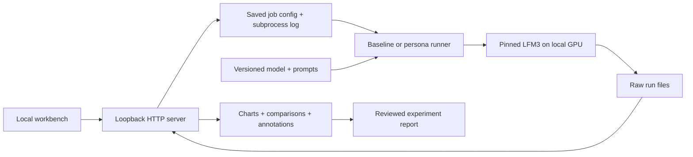

# How the lab fits together

The interactive path is `ui/workflow.js` → loopback `/api/live` in `scripts/viewer.py` → one local `scripts/live_worker.py` process. `configs/models.json` separates LFM3 reversible-hook recipes from Qwen's base/published checkpoint pair. The worker records both branches, actual messages, token IDs, timing, source hashes and parameter-version checks under `runs/*-LIVE-*`; it retains one loaded checkpoint until model change or idle timeout. Stop tracks Windows virtualenv launcher children as well as the parent. Research batch designs remain LFM3-specific.

`scripts/catalog.py` derives stable recipe IDs from exact model/operator identities and hook implementation fingerprints, attaching separate scoped observations. Local annotations live under ignored `runs/`; reviewed public names live in `experiments/personas/names.json`. Public catalog generation excludes interactive chat runs and their observations. Public numeric evidence and reviewed examples are deliberately exported into `experiments/evidence/`, separately from private raw run storage. These distinctions are enforced independently of the UI's model filters.

## Responsibility boundaries

`scripts/lab.py` owns model loading, baseline generation, environment capture and the MLP gain hook. Model/cache files live under project .cache by default. `HF_HOME` can be overridden explicitly by the caller.

`scripts/personas.py` owns contrast discovery and the additive decoder-output hook. It records actual configuration and hashes, saves directions, checks hook neutrality/cleanup and writes every completed generation. Its initial candidate is a difference between generated-response means; it is not a discovered single neuron.

`scripts/explore.py` preserves the original pilot workflow. `scripts/map_experiment.py` handles newer versioned mapping and replication designs, with `design.py` selecting candidates and controls and `measurements.py` recording transparent surface checks. Cohort and role labels distinguish fresh prompts, discovery anchors, target candidates and random controls. `verify_run.py` checks completed mapping records against archived hashes and their shuffled trial schedule. `summarize.py` keeps these groups separate.

`scripts/viewer.py` serves static UI files and local JSON APIs. It never loads the model into its own process. It launches allowlisted scripts with the same Python interpreter, allowing at most one detected lab experiment process at a time. It does not provide a general shell or arbitrary file endpoint.

`scripts/calibrate.py` collects gated-activation statistics and screens signed constant offsets before the MLP output projection. `calibration.py` owns offset cleanup, local normalization-aware calibration and deterministic selection. `calibrated_map.py` consumes the frozen screen and generates disjoint evaluation replies, measuring actual prefill effects against the same prompt's unsteered activations. `evidence_report.py` verifies source hashes, selection and trial schedule, exports numeric public evidence, and renders scientific PNG/SVG figures. Raw text, token sequences and activation tensors remain local.

`ui/` presents measurements and plain-text model output. It does not calculate a scientific success verdict. Human review notes are separate from raw generations. Automatic polling refreshes local run data every five seconds.

## Evidence files

| File | Meaning |
|---|---|
| metadata.json | Model revision, config, environment, settings and source hashes |
| outputs.json | Prompts, token IDs, output text, condition and timing |
| checks.json | Explicit hook checks; passing these does not establish a useful effect |
| directions.pt | Locally derived directions and neutral norm references |
| direction-diagnostics.json | Contrast sizes and pair agreement with the mean |
| random-vectors.pt | Seeded random control vectors |
| summary.json | Runner completed and condition counts; not a quality score |
| annotations.json | Human labels and notes, saved by the viewer |
| source/ | Exact local runner, persistence, config, prompt and lock snapshots for new runs |
| trial-order.json | Pre-saved shuffled intervention schedule for newer mapping runs |
| runs/jobs/ID/config.json | Exact launch config for a managed persona run |
| runs/jobs/ID/stdout.log | Model load, runner progress and errors |

Raw run data stays local by default. Reviewed findings are written under experiments/ and committed with limitations. Preserve a run even if it fails or contradicts the original idea.
