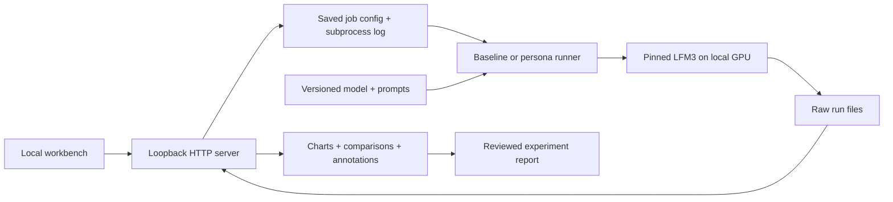

# How the lab fits together

## Responsibility boundaries

`scripts/lab.py` owns model loading, baseline generation, environment capture and the MLP gain hook. Model/cache files live under project .cache by default. `HF_HOME` can be overridden explicitly by the caller.

`scripts/personas.py` owns contrast discovery and the additive decoder-output hook. It records actual configuration and hashes, saves directions, checks hook neutrality/cleanup and writes every completed generation. Its initial candidate is a difference between generated-response means; it is not a discovered single neuron.

`scripts/viewer.py` serves static UI files and local JSON APIs. It never loads the model into its own process. It launches allowlisted scripts with the same Python interpreter, allowing at most one detected lab experiment process at a time. It does not provide a general shell or arbitrary file endpoint.

`ui/` presents measurements and plain-text model output. It does not calculate a scientific success verdict. Human review notes are separate from raw generations. Automatic polling refreshes local run data every five seconds.

## Evidence files

| File | Meaning |
|---|---|
| metadata.json | Model revision, config, environment, settings and source hashes |
| outputs.json | Prompts, token IDs, output text, condition and timing |
| checks.json | Explicit hook checks; passing these does not establish a useful effect |
| directions.pt | Locally derived directions and neutral norm references |
| direction-diagnostics.json | Contrast sizes and pair agreement with the mean |
| random-vectors.pt | Seeded random control vectors |
| summary.json | Runner completed and condition counts; not a quality score |
| annotations.json | Human labels and notes, saved by the viewer |
| source/ | Exact local runner, persistence, config, prompt and lock snapshots for new runs |
| runs/jobs/ID/config.json | Exact launch config for a managed persona run |
| runs/jobs/ID/stdout.log | Model load, runner progress and errors |

Raw run data stays local by default. Reviewed findings are written under experiments/ and committed with limitations. Preserve a run even if it fails or contradicts the original idea.
