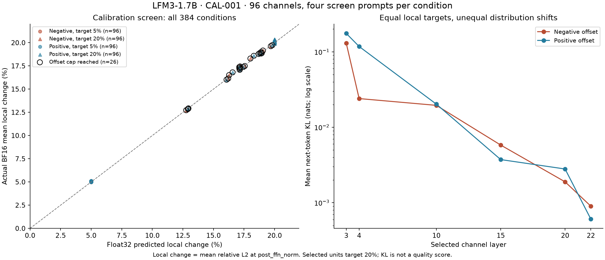

# CAL-001: calibrated offset mapping

Status: complete exploratory screen. The plan below was committed before screening, and the evaluation runner before generation. [MAP-005 findings](MAP-005-calibrated-effects.md) include the completed evaluation and recovery provenance.

## Milestones and scope

1. Measure gated MLP activation RMS for all 184,320 channels on 12 neutral calibration inputs.
2. Uniformly sample 16 channels in each of six layers (96 total). Calibrate positive and negative constant offsets toward 5% and 20% mean relative change of that block's post-normalized MLP output, capped at 32 times the channel's calibration RMS.
3. Screen the 384 interventions on four calibration inputs, recording actual BF16 local output change and next-token KL(P_baseline || P_changed). This is not a generation/personality score.
4. Freeze one candidate per layer using only screen measurements. Prefer the larger target; require both signs to meet ±25% target tolerance, no cap hit, and each sign's mean KL <=0.5 nats. Choose the lower median candidate ranked by paired mean KL. Fall back to 5% or skip a layer if no candidate qualifies. Publish all screen outcomes, including ineligible cases, in the local evidence.
5. Evaluate both signed offsets for the frozen candidates on 16 different prompts covering six exact checks and ten behavioral domains. At six selected units, this is 16 baselines + 2 neutral/cleanup checks + 192 interventions = 210 generations. Fewer selected units reduce the count explicitly.

## Definitions and controls

Calibration uses non-special prompt tokens except position zero, including the neutral system instruction. RMS pools observed token positions; it is not a population estimate over arbitrary language. Native channel offsets are applied before w2 and post_ffn_norm, to all prompt and generated-token positions. Float32 local calibration is an approximation; the screen measures the actual BF16 forward effect. A 20% MLP-output change is not a 20% change in the full residual stream or behavior.

The 96 channels are selected before outcomes using seed 20261106. Signed and strength pairs expose dose sensitivity. Random sampled units form a reference cohort, but choosing a screen-median candidate is a selection procedure; generation results do not become independent random-unit estimates. Candidate selection never uses generated character labels or evaluation outputs. Greedy generation is a single trajectory per condition, not multi-seed validation.

The calibration inputs and the 16 evaluation prompts are disjoint. The latter will be inspected for effect descriptions and are therefore exploratory, not a future held-out validation set. Six exact checks measure narrow task/format behavior only; qualitative correctness for the other ten prompts requires review. Gains and calibrated offsets are separate intervention families.

## Evidence and deliverable

Keep all activation statistics, offsets, achieved effects, per-prompt screen rows, selected candidates, neutral checks, generation schedules, complete outputs and code/config snapshots locally. Create a repository report with reviewed aggregate figures and representative successes/failures. Preserve the current workbench and make calibrated results browsable. No weight training or permanent checkpoint change.

## Screen results (2026-11-06)

Run: `20261106T192008134252Z-CAL-001-calibration`. Completed 1,536 screen forwards for 384 conditions across 96 sampled channels. All 184,320 MLP channels have calibration RMS/max statistics over 405 selected input positions per layer. This is a small, specific calibration corpus, including system tokens, not a broad activation atlas.

26/384 conditions reached the 32-RMS offset cap. These outcomes remain in the screen evidence and were ineligible for selection. All six layers supplied a qualifying paired candidate at the preferred 20% target; no fallback or skipped layer was required. The twelve selected signed offsets achieved mean local changes between 19.92% and 20.32% on the four screen prompts. Zero-offset logits and removed-hook logits matched exactly; parameter version counters were unchanged.

| Layer / channel | Operator | Negative KL (nats) | Positive KL (nats) |
|---|---|---:|---:|
| L03N6960 | convolution | 0.129708 | 0.175264 |
| L04N5848 | sliding attention | 0.023999 | 0.117567 |
| L10N4117 | full attention | 0.019514 | 0.020243 |
| L15N6252 | convolution | 0.005809 | 0.003731 |
| L20N0472 | sliding attention | 0.001893 | 0.002800 |
| L22N0450 | full attention | 0.000901 | 0.000607 |

Equal local targets produced unequal next-token distribution shifts for these selected units. Layer and operator effects are confounded, each layer contributes only one selected unit, and selection itself uses KL. This table cannot establish a general layer-sensitivity law or superior behavior. The next stage uses all twelve frozen offsets on 16 different prompts.

The [numeric evidence](evidence/CAL-001/metrics.json) includes all 384 conditions, including capped cases, and each condition's four actual screen measurements. Float32 predictions track actual BF16 means closely in this screen; this is local calibration evidence, not a behavioral guarantee. Candidate selection and saved means were independently recomputed by the report exporter. The PNG was visually inspected; editable SVG is supplied alongside it.
