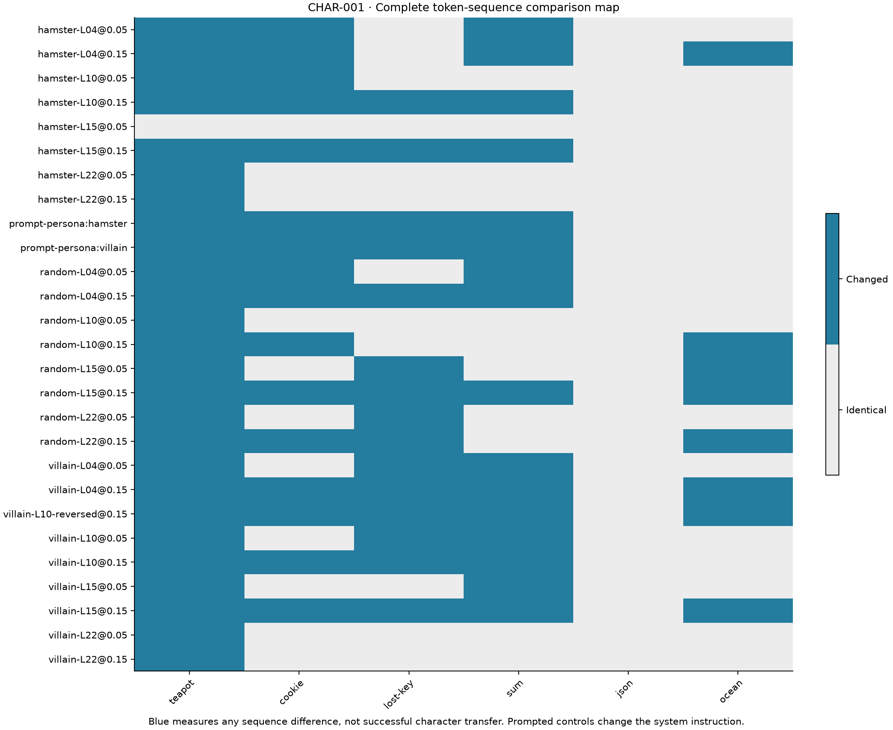
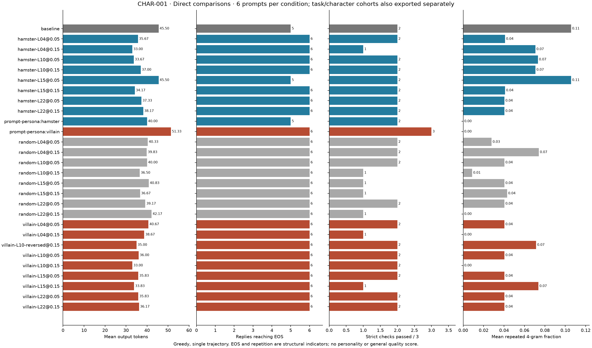
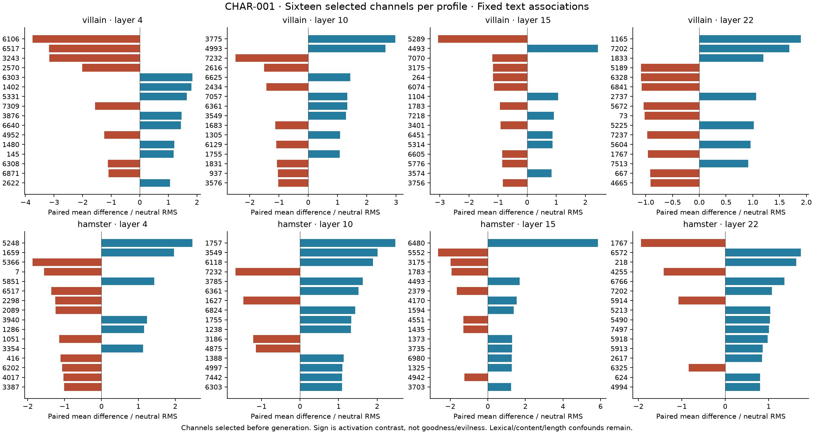

# CHAR-001: sparse character profiles

Status: complete exploratory run. The design below was committed as bd5696e before generation. No coherent internally induced character has been validated.

Model remains the pinned LiquidAI LFM3-1.7B. Try a new extraction method, preserving previous failed persona sweeps: teacher-force eight hand-authored neutral/villain/hamster response triples under the same neutral system and paired user prompts. Average each channel's gated MLP input over non-special response tokens, with equal weight per response. This captures text/style/content associations, not a proven character representation. Text lengths differ and lexical content is a confound.

For each style/layer, rank channels by absolute paired mean difference divided by neutral response RMS, requiring sign agreement on at least six of eight pairs. Select sixteen before looking at evaluation text. Normalize their standardized differences to unit L2, then multiply each channel by its neutral RMS to form a sparse native-activation profile. Retain all 24-layer rankings and feature tensors locally. Test layers 4, 10, 15 and 22, spanning sliding attention, full attention and convolution blocks.

Calibrate profile amplitude to 5% and 15% mean relative L2 change at post_ffn_norm on eight neutral prompt prefills, excluding special tokens and position zero. Cap the multiplier at 32; report any unreachable target. Record actual BF16 effects on four calibration prefills. Controls use sixteen random channels per layer, excluding both style selections, Gaussian signed weights and the same achieved-strength calibration. Include a reversed villain profile at layer 10 / 15%. No channel/persona is selected using evaluation outputs.

Six disjoint evaluation prompts: three playful scenarios and three strict checks. Compare identical neutral baselines, ordinary persona prompting, internal profiles at both strengths, sparse random controls at both strengths, and the reversed profile. Planned: 6 baselines + 12 prompted characters + 96 style-profile replies + 48 random replies + 6 reversed replies + 2 hook checks = **170 generations**. Greedy, cap 128. All outcomes remain recorded, including no effect and damage. Fixed seed controls profile/control/trial selection, not independent generation replicates.

Record matched baseline token changes, actual prefill strength, EOS, repetition, narrow exact checks, transparent character vocabulary hits, timing and raw text. Vocabulary is a browsing aid, never a personality/quality score. Describe tone, content, structure and damage separately. An internal character claim requires coherent transfer across fresh contexts, stronger evidence than random controls, task preservation and later replication. Ordinary prompting is a practical comparison, not proof the internal edit works.

Artifacts: source/config hashes, teacher-forced features, ranked channel maps, sparse recipes, float32 calibration and BF16 checks, shuffled trial schedule, raw replies, direct-comparison workbench and reviewed report/figures. No training, weight rewrite, admin or paid compute.

## Results (2026-11-06)

Run `20261106T195602981114Z-CHAR-001-sparse-characters` completed all 170 generations. Eleven source/input archives and all 162 scheduled trials verified (150 sparse interventions + twelve prompted controls). Neutral/removal checks and unchanged parameter version counters passed. All 25 profiles calibrated without reaching the amplitude cap. Across evaluation prefills, measured local changes ranged from 4.67% to 15.70% across the two nominal strengths.

73/150 sparse intervention replies changed token sequence. **The internal profiles did not produce a convincing transferable villain or hamster character.** This is an exploratory qualitative conclusion based on direct output inspection, not a validated style classifier. The vocabulary indicators recorded no character-term hits for the internal profiles; they also miss clear prompted villain style, illustrating why they cannot decide success.

## Direct comparisons

For the cookie scenario, baseline offers an awkward sharing/apology response and repeats part of it around a think-boundary marker. Ordinary villain prompting produces: “Oh, my dear, you have betrayed the sacred confection!” and continues with melodramatic poison/feasting imagery. Ordinary hamster prompting offers crumbs and a hamster emoji. These are reviewed examples of **prompted** characterization, not neuron-edit successes.

The internal `villain-L10@0.15` reply instead starts “Gross, but I guess it's better than nothing left for someone else to have” and later complains that everyone shares the guilt. This is a more negative-sounding response on one scenario, but the same profile's teapot and key replies do not sustain theatrical villain characterization. The matched random L10 profile also changes the cookie tone, saying it is glad the cookie is gone. It would be premature to call the selected profile an evil feature.

`hamster-L10@0.15` changes the teapot scene and cookie response without making them recognizably hamster-like. Several late-layer conditions and the weaker L15 hamster condition leave many or all replies unchanged. The reversed L10 villain profile changes five of six token sequences, without establishing an opposite personality.

## Collateral task and structure effects

Baseline passes 2/3 exact checks: it incorrectly answers `58` for 27+16, while JSON and ocean-name checks pass. All sparse conditions pass only 1/3 or 2/3; none repairs that arithmetic example. Some introduce an extra think-boundary/repeated ocean answer and lose that format check. Ordinary villain prompting passes 3/3 on this tiny set, while ordinary hamster prompting passes 2/3. That is a narrow prompt-level observation, not a benchmark improvement.

Most sparse conditions change baseline completion from 5/6 to 6/6 and reduce repeated-token fractions. Random profiles often do the same. The weaker hamster L15 profile is token-identical on all six prompts and retains 5/6 EOS. Character-aligned and random profile changes therefore overlap substantially on structural outcomes.

## Channel associations

The map shows sixteen selected channels per tested layer/character. Signed values are paired mean differences divided by neutral response RMS; sign is not goodness/evilness. The hand-authored response texts differ in vocabulary, content and length, so these are associations used to choose an intervention, not discovered neuron functions. Rankings for both characters across all 24 layers and the exact tested sparse recipes are in the [numeric export](evidence/CHAR-001/metrics.json). Full feature tensors and raw responses remain local.

Next experiment [CHAR-002](CHAR-002-joint-characters.md) combines profiles across layers and escalates amplitude. It is separately predeclared after inspecting this run; its fresh prompts cannot retroactively validate CHAR-001. The practical character control remains ordinary prompting until internal transfer survives fresh comparisons and collateral checks.

Figures redraw without model/run files using `uv run --locked --extra analysis python scripts/campaign_report.py --evidence experiments/evidence/CHAR-001/metrics.json --destination .cache/redrawn-CHAR-001`. PNG and SVG are supplied. No confidence intervals or personality score are claimed.
