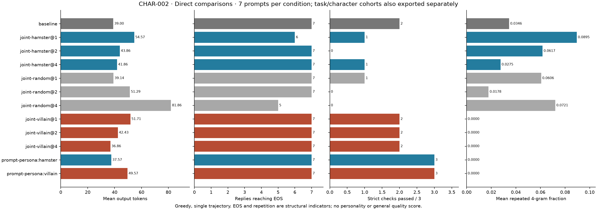
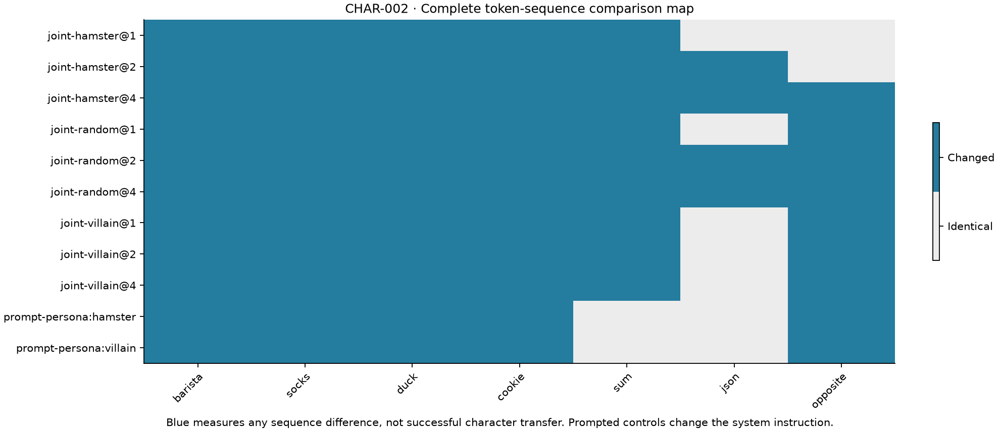
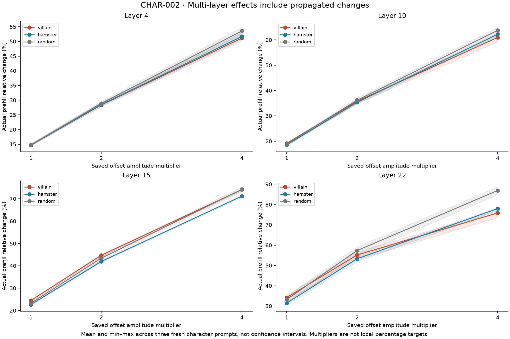

# CHAR-002: combine and amplify sparse character profiles

Status: completed; no coherent internal villain or hamster persona established. The design below was predeclared after inspecting CHAR-001 and before these generations.

CHAR-001's isolated-layer profiles did not show convincing character transfer. Test a separate interaction hypothesis: simultaneously apply the saved 15%-target offsets at layers 4, 10, 15 and 22, for villain, hamster and random profiles. Multiply all offsets by 1, 2 or 4. These settings are **amplitude multipliers**, not newly calibrated percentages. Upstream perturbations alter downstream activations; record actual prefill differences by layer rather than presenting one pooled strength number.

Three fresh playful scenarios, the labeled cookie anchor, three fresh strict checks. Include ordinary persona prompts, neutral baselines, joint zero-hook/removal checks and unchanged parameter-version checks. Planned 7 baselines + 14 prompted-character controls + 63 joint-profile replies + 2 checks = **86 generations**. Greedy, cap 128. No post-generation candidate selection, rerolling or damage exclusion. Preserve the original CHAR-001 recipes and both experiments independently.

Describe full outputs and compare random profiles; word hits alone cannot establish character transfer. High-dose incoherence or repetition counts as damage. A successful demonstration still needs fresh replication and collateral-task checks. This is not a claim to have found an evil neuron.

## Results

Run `20261106T201009924785Z-CHAR-002-joint-characters` completed 86 generations. All 77 scheduled conditions (including 14 prompted controls), archived source hashes, zero-offset/removed-hook checks and parameter-version counters verify. **56/63** joint-profile replies changed tokens. Changes alone did not establish a persona. [Numeric evidence](evidence/CHAR-002/metrics.json) separates the three fresh character prompts, three fresh checks and cookie anchor.

| Condition | EOS / 7 | Fresh exact checks / 3 |
|---|---:|---:|
| Default | 7 | 2 |
| Villain ×1 / ×2 / ×4 | 7 / 7 / 7 | 2 / 2 / 2 |
| Hamster ×1 / ×2 / ×4 | 6 / 7 / 7 | 1 / 0 / 1 |
| Random ×1 / ×2 / ×4 | 7 / 7 / 5 | 1 / 0 / 0 |

Villain-derived profiles did not consistently produce villain characterization. At ×4 the cookie response instead said: “I'm glad your friend enjoyed that final cookie! A shared snack like this is always a sweet moment to celebrate together.” It also misreads the theft as sharing. **Cookie Diplomat** is a provisional nickname for that observed response, not a validated general personality. Ordinary prompted controls remain the clearer character demonstrations.

Hamster-derived and random profiles caused substantial exact-check regressions. Random ×4 averaged 81.86 output tokens versus default 39, produced repeated laundry advice and capped two replies; **Laundry Rambler** documents this damaged condition rather than a useful persona.

Actual changes grew across the four layers because earlier edits propagate. The saved 15%-target per-layer offsets produced roughly 15–34% measured changes at ×1 on the fresh character prompts; villain ×4 reached roughly 51–76%, and random late-layer effects reached about 87%. These are local prefill effects, not behavioral percentages or confidence intervals.

