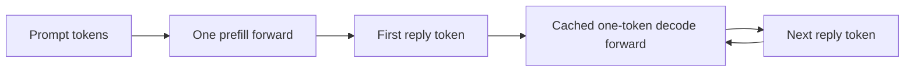

# LFM-010: when does a sparse character intervention act?

Status: **implemented and verified offline; MPS research execution pending**. No LFM3 weight loading, calibration or research generation in this experiment yet. Existing MPS compatibility evidence is BACKEND-001. The protocol and implementation must be committed before inference. QWN-003 remains a separate, resource-refused study.

## Question and fixed choice

Does restricting a small villain-derived intervention to prefill or cached decode yield clearer characterization with fewer task regressions than applying the same offsets during both? The hypothesis is that phase placement may matter. Output changes cannot by themselves demonstrate better comprehension, a personality representation or increased capability.

Use the published CHAR-001 **villain-L10@0.05** sparse direction and **random-L10@0.05** control. The artifact contains their sixteen channel indices and native vector components; no historical private tensor files are required. Channels/direction are frozen, not selected from new Mac replies. The historical villain-L10 observation motivates the choice; it did not validate this profile as a character. Original Windows amplitudes are ignored. Recalibrate both native vectors on MPS before generating evaluation text.

Model is LiquidAI/LFM3-1.7B, revision `0dc4268b561499c648c7ba7c9466bf3d8d01517a`; MPS/BF16/eager attention, seed 42, greedy, thinking requested off, cached generation. Preserve the checkpoint's other generation defaults, including repetition penalty; record them. No training, checkpoint edits or dose escalation. Exact source-artifact/model/prompt hashes and resource settings are frozen in [lfm-phase-timing.json](../configs/lfm-phase-timing.json).

## What the phases actually mean



- **Prefill-only:** offset every prompt position in the first model forward. This also influences the first reply token and cached state carried into later decoding.
- **Decode-only:** leave that first forward unchanged; offset subsequent one-token model forwards. It first affects the second reply token. A reply ending after one token has no decode intervention.
- **Both:** intervene in the first and all subsequent forwards.

The gate counts model forward calls and resets for each generation. It does not guess phase from sequence length: a one-token prompt is still prefill. Chunked prefill, full-prefix recomputation during decode, beams and batches are outside this frozen protocol. The hook changes gated MLP input before w2/post_ffn_norm. It preserves input/parameter tensors and removes both hooks even on exceptions. See the [PyTorch hook API](https://docs.pytorch.org/docs/2.14/generated/torch.nn.Module.html#torch.nn.Module.register_forward_pre_hook) and [cached next-token inference](https://huggingface.co/docs/transformers/v5.22.2/cache_explanation).

## Small calibration before generation

Four fixed neutral inputs in [phase-calibration.json](../prompts/phase-calibration.json), disjoint from evaluation. Collect w2 outputs and post_ffn_norm references at non-special prompt positions except position zero, including system tokens. For each frozen sparse vector, approximate the normalized local output in float32 and bisect a positive multiplier toward **5% mean relative L2 change**. Cap multiplier at 32, use sixteen iterations, then measure actual BF16 change on all four prefills.

Both target/control must be uncapped and within ±25% of the 5% target, or stop before evaluation. Save actual per-prompt strengths, vector components, fitted amplitudes, offsets, input IDs/masks and raw local tensors. A common nominal target is a local prefill-strength match, not a whole-residual, semantic or decode-position match. Exactly the same fitted offsets are used for all three placements. Decode-position strengths are not measured in this first experiment; they may differ from prefill calibration.

## Frozen evaluation and cost

Six new prompts in [phase-evaluation.json](../prompts/phase-evaluation.json): toaster union, sandwich-claiming robot, shopping-cart mayor, plus addition, strict JSON and a chemical-symbol check. Evaluation prompts omit villain/hamster instructions. They are untouched by this experiment, but this is exploratory evaluation; after inspection they cannot be reused as held out. Three character prompts, one random vector and one greedy trajectory per condition provide no significance estimate.

| Condition | Prompt system / intervention | Replies |
|---|---|---:|
| Default | Shared neutral instruction | 6 |
| Prompted villain | Same neutral instruction plus ordinary character instruction | 6 |
| Internal villain, three placements | Neutral instruction; MPS-calibrated frozen vector | 18 |
| Random control, three placements | Neutral instruction; same-layer/same-size calibrated vector | 18 |
| Zero/removal checks | One zero-offset and one restored run per placement on first scenario | 6 |
| **Total** | **48 probe replies + 6 checks** | **54** |

Baselines first; six zero/removal checks next; then shuffle the remaining 42 probes with frozen seed 20261109. The planner constructs the complete product and saves the exact order before execution. Six hook-check replies must match baseline tokens exactly. Each generation has at most **192 input tokens / 48 new tokens**, **2,592 generated tokens total**, and an **eight-minute cumulative wall ceiling** including identity/load/calibration. Short caps may censor characterization; cap/EOS differences remain visible rather than excluded. No adaptive reroll, replacement or higher dose after inspection.

## System pressure and cancellation

This model needs more headroom than Qwen. Require normal macOS dispatch pressure 1 and **7 GiB available before loading**, stop below **3 GiB available**, above **256 MiB swap growth**, above **6 GiB RSS or MPS driver allocation**, on thermal/performance warnings/unknown telemetry, or below **5 GiB disk space**. The larger start floor reserves space for roughly 3.5 GB of weights plus runtime allocations while retaining the running floor. Lower the process MPS allocator fraction to **0.40** of Metal's recommended working set (about 5.33 GiB here), use two CPU threads/one interop thread and increase process niceness by ten. No changes to other apps, global settings or memory-pressure controls.

Reuse the tested resource sampler: memory every second, thermal status every five seconds, latched stop on any breach. Check at every generated token and between calibration forwards. SIGINT/SIGTERM and a STOP file in the printed run directory trigger cooperative cancellation. Save actual input IDs and raw token checkpoints every sixteen tokens and on generation exceptions. In-flight kernels, loading or file operations cannot be preempted perfectly; the lower allocator limit provides an independent ceiling. No automatic retry or exact KV/RNG continuation. This short runner deliberately has no resume command; preserve partial runs and never present an interrupted reply as a complete paired condition.

## Scoring and a reviewable decision

Keep **answer match**, **strict format**, EOS, token count, repetition and phase-call trace separate. Integer scoring requires one unambiguous standalone integer in the final segment; a correct number somewhere in a calculation is insufficient. JSON content can be recovered from one object wrapped in prose, but strict format fails. Changed JSON types fail strict comparison; the chemical symbol is case-sensitive (Au). A last think-boundary permits separate final-answer scoring while strict whole-output format still fails. These conservative extractors do not grade general correctness; ambiguous extraction stays ungraded. No character score is inferred from vocabulary hits.

For a complete run, export a private shuffled review pack of the 24 behavioral replies with neutral review IDs and without condition/phase labels. Keep the key in a separate file. Rate each reply 0–2 on:

| Dimension | 0 | 1 | 2 |
|---|---|---|---|
| Villain style | Ordinary voice | Isolated style cue | Sustained theatrical characterization |
| Coherence | Broken/incoherent | Partly coherent or repetitive | Coherent |
| Task relevance | Does not answer | Partly addresses request | Answers actual request |

Obvious prompted style may reveal a condition; this is label blinding, not guaranteed reviewer blinding. Ratings are bound to raw-output and review-pack hashes and require one unique complete rating per item. Human comments stay local. Until ratings exist, report **manual review required**, never an invented persona verdict.

A phase only nominates a candidate for later fresh replication if at least two of its three villain replies score 2 on all dimensions, that count exceeds its matched random phase, it loses no baseline-passed answer/format check and adds no EOS failure. Report every lost check individually. A weak baseline limits preservation evidence. This is an exploratory nomination rule; even passing it does not validate a persona or a capability gain. If no phase qualifies, preserve that negative result and reconsider extraction/placement rather than escalating automatically.

The **primary timing comparison is decode-only versus both**: decode-only must qualify above, have more qualifying villain replies than both, and improve the villain-minus-random count over both. It must also lose no answer/format check or EOS success relative to both. Prefill-only is an exploratory phase comparison. A nomination against random alone is not evidence that restricted timing beats both. These tiny count rules select a replication candidate; they provide no significance estimate.

## Commands and evidence

```sh
# Offline: verifies frozen inputs and prints the complete bounded plan; no torch/model load.
uv run --locked python scripts/phase_experiment.py plan
# Only after committing the protocol/source and meeting resource admission:
uv run --locked python scripts/phase_experiment.py run
# Verify source/config/schedule/phase traces and recompute task scores:
uv run --locked python scripts/phase_report.py RUN-ID
# For a complete run, generate private review items/key/instructions:
uv run --locked python scripts/phase_report.py RUN-ID --blind-review
# Add the actual human ratings file, then export deliberately reviewed numeric evidence:
uv run --locked python scripts/phase_report.py RUN-ID --ratings PATH-TO-RATINGS --publish
```

Local evidence includes source snapshots, predeclared commit, config, trial order, weight identity, generation defaults, calibration inputs/tensors/screens, neutral checks, forward traces, full replies/input/output IDs, task scores, partial checkpoints, resource timeline and cleanup. Numeric reporting validates the saved schedule against the full frozen design, not merely a count or saved prefix. It also checks baseline input equality, stream/returned-token consistency, calibration strength, EOS and parameter checks. Raw text/tokens/review packs remain ignored. The workbench can browse saved comparisons if started manually; this implementation does not start it.

## Verification before first MPS execution

Offline checks cover one-token prefill, full prompt positions, exact prefill/decode/all placement, one-token EOS with no decode intervention, invalid decode shapes, zero offsets, exception cleanup and unchanged weights/inputs. Tiny randomly initialized CPU Hugging Face models verify that streaming matches ordinary generation and resource cancellation retains the actual generated token; these are test models, not LFM3 results. Report tests reject duplicated schedule rows, changed cohort labels, wrong-phase intervention traces and incorrect intervened-position counts, keep manual review pending, require complete unique ratings, and block a nomination after an individual format loss. A separate primary-comparison test rejects ties with both-phase steering and completion losses against both. The planner is tested in a separate process to confirm it imports no torch.

The initial read-only host check reported elevated pressure 2 and about 3.75 GiB available, below this experiment's start floor. No LFM3 research run or automatic retry was attempted while building. Real MPS calibration, phase neutrality and the 54-reply campaign remain unverified until the guarded run is admitted. Services remain shut down after implementation; the CLI plan is available without loading weights.
