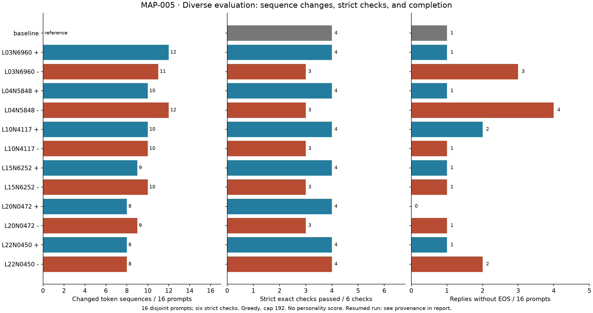
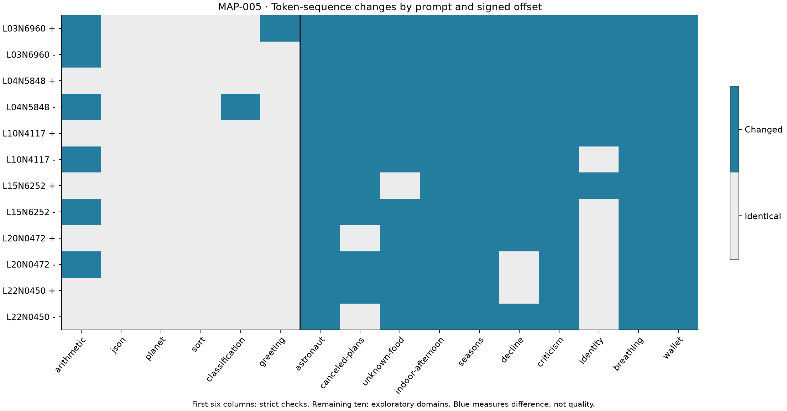

# MAP-005: calibrated changes, observable tradeoffs

Status: complete exploratory measurement. No personality trait or capability gain validated.

We calibrated single-channel offsets, then tested six frozen channels at both signs on 16 separate prompts. **117/192 intervention replies changed token sequence; 75 were identical. No condition exceeded the baseline's 4/6 strict-check score.** One offset cleaned up a repeated translation while also changing a correct arithmetic answer to an incorrect one. This is useful causal evidence about an intervention, with collateral effects, rather than a successful personality recipe.



## Design and provenance

- Model: `LiquidAI/LFM3-1.7B`, revision `0dc4268b561499c648c7ba7c9466bf3d8d01517a`; BF16, eager attention, greedy generation, seed 42, requested thinking disabled, 192-token reply cap. The checkpoint can still emit think-boundary markers.
- Neutral system: “You are a helpful assistant. Answer clearly and concisely.” No character instruction is supplied.
- Intervention: add a constant native-activation offset to one gated MLP channel at `w2` input, before `post_ffn_norm`, at every prompt and decode position. No training or checkpoint rewriting.
- Selection: [CAL-001](CAL-001-calibrated-mapping.md) used 96 sampled channels / 384 conditions and four calibration inputs. Both signs of a screen-median eligible channel were frozen in each of six layers, before inspecting evaluation text. All selected pairs use the preferred 20% local-change target.
- Evaluation: [six exact checks and ten behavioral prompts](../prompts/diverse-evaluation.json), disjoint from calibration prompts. One greedy trajectory per condition. These prompts are now inspected discovery evidence, not a future held-out test.
- Counts: 16 baselines + two initial hook checks + 192 interventions = 210 mapping records. Recovery added 18 separately recorded baseline/hook-check generations. These are replay checks, not independent behavioral replications.

Screen: `runs/20261106T192008134252Z-CAL-001-calibration/`. Interrupted evaluation: `runs/20261106T192416741828Z-MAP-005-calibrated-offsets/`. Completed continuation: `runs/20261106T193431789097Z-MAP-005-resumed-offsets/`. Raw outputs and tensors stay local; reviewed numeric evidence is [published here](evidence/CAL-001/metrics.json).

The original process stopped after 196 saved replies with Windows `PermissionError` during atomic file replacement. Its prior JSON remained intact. A separate runner preserved and hashed the parent evidence, confirmed its trials form an unchanged unique schedule prefix, and replayed all 16 baselines. All baseline tokens and all captured prefill tensors matched exactly before the final 14 interventions ran. Zero-offset / removed-hook checks passed again. The resumed model's parameter version counters were unchanged. **The interrupted segment has no final parameter-version check**; the resumed check cannot retroactively provide one. Storage now retries transient sharing failures, with persistent errors still reported.

Source/input archives (26 files), exact 192-trial schedule, frozen candidate selection, full candidate/prompt coverage, inherited-output prefix and stored reply measurements all verified. The pre-generation plan was committed as `e3a8b90`, evaluation runner as `1fa1421`, and recovery runner/fix as `de294b4`.

## Results

Signs below identify separately calibrated native offsets. They are not gains or residual-direction doses. Exact checks combine answer and strict formatting; the remaining ten domains have no automatic correctness grade. Mean lengths and repetition fractions use the same 16 prompts for every row. EOS indicates termination within budget, not correctness or a validated loop repair.

| Condition | Changed / 16 | Strict checks / 6 | EOS / 16 | Mean tokens | Mean repeated 4-gram fraction |
|---|---:|---:|---:|---:|---:|
| Baseline | reference | 4 | 15 | 74.69 | 0.0104 |
| L03N6960 + | 12 | 4 | 15 | 62.94 | 0.0036 |
| L03N6960 − | 11 | 3 | 13 | 97.94 | 0.0124 |
| L04N5848 + | 10 | 4 | 15 | 61.75 | 0.0107 |
| L04N5848 − | 12 | 3 | 12 | 83.56 | 0.0115 |
| L10N4117 + | 10 | 4 | 14 | 79.88 | 0.0155 |
| L10N4117 − | 10 | 3 | 15 | 78.50 | 0.0114 |
| L15N6252 + | 9 | 4 | 15 | 72.19 | 0.0112 |
| L15N6252 − | 10 | 3 | 15 | 66.56 | 0.0122 |
| L20N0472 + | 8 | 4 | 16 | 63.50 | 0.0123 |
| L20N0472 − | 9 | 3 | 15 | 70.31 | 0.0123 |
| L22N0450 + | 8 | 4 | 15 | 68.94 | 0.0106 |
| L22N0450 − | 8 | 4 | 14 | 70.75 | 0.0129 |

Across all 192 intervention replies, achieved mean relative prefill changes ranged from **18.15% to 20.97%**, compared with selected screen means of 19.92–20.32%. This supports approximate strength transfer to these prompts. It measures the intervened block's post-normalized MLP output, includes neutral system tokens, and excludes position zero / special tokens. Decode-position strength and whole-residual-stream strength were not measured.



## What actually changed

**A cleanup with a factual regression.** On `greeting`, baseline text was `Buenos días</think>Buenos días`. L03N6960's positive offset (`+0.8512593681`, about `+17.092` calibration RMS) returned only `Buenos días`, satisfying the exact check. But on `arithmetic`, the same offset changed the correct `43` to `49` for “19 plus 24.” Its total remains 4/6 because the gained translation check replaces a lost arithmetic check. Other eleven offsets retained the original translation sequence. This candidate does not support a general thinking-marker or repetition fix: it still emits `</think>` on the rainy-afternoon prompt.

**Several edits reach the same wrong answer.** The negative offsets at L03N6960, L10N4117, L15N6252 and L20N0472 also returned `49` on that arithmetic input. L04N5848's negative offset instead returned the correct calculation followed by the answer again, failing the “only the integer” constraint. Those are different failure types. A shared alternate answer across several units is weak support for assigning a unique neuron function.

**Possible compression, with a cap tradeoff.** L04N5848's positive offset shortened seven of ten behavioral replies, lengthened three, and kept the six exact-check token sequences unchanged. The unknown-neighbor-food response changed from 79 tokens with a think-boundary restart to a direct statement that it does not know; the rainy-afternoon response changed from a capped 192-token list to a 76-token completed suggestion. However, its astronaut scene hit the cap where baseline finished, leaving total EOS at 15/16. “Concision candidate” is a tentative structural observation, not a replicated personality trait or net completion improvement.

**A narrow completion opportunity.** L20N0472's positive offset completed the rainy-afternoon reply in 98 tokens and reached EOS on all 16 prompts, versus baseline's 15/16. It preserved all six exact-check sequences. This is one repaired capped discovery prompt with a baseline ceiling on the other fifteen; no fresh completion replication exists yet.

**Identity and uncertainty remain largely ordinary.** All inspected identity introductions still identify as LFM/Liquid AI, with wording/length changes rather than a discovered character identity. Several are token-identical. All thirteen inspected neighbor-food replies acknowledge that the information is unavailable; the amount of explanation and boundary-marker use vary. These limited observations do not establish broader honesty, personality, or hallucination rates. Other domain outputs are retained for local review; there is no comprehensive subjective grading claim.

## What to test next

Freeze two tentative descriptions before collecting more evidence: L04N5848 positive as a possible compression control, and L20N0472 positive as a possible completion/length control. Use fresh prompts, explicit format/cap guardrails, smaller offsets, and randomly chosen same-layer channels with matched achieved local strength. Reuse the old examples only as labeled anchors. A broader set of arithmetic checks should distinguish wrong answers from format regressions. Do not call either candidate a useful recipe until that replication is complete.

## Reproduce the figures

The [numeric export](evidence/CAL-001/metrics.json) contains all 384 screen conditions, twelve selected offsets, 208 probe measurement rows, aggregates, model/config details, hashes and limitations. It excludes raw reply text, token sequences and activation tensors. Three figures are supplied as PNG and editable SVG; all PNGs were visually inspected for labels, clipping, legends and matching counts. Browser visual QA for the workbench remains pending.

```powershell
uv sync --locked --extra analysis
uv run --locked --extra analysis python scripts/evidence_report.py --evidence experiments/evidence/CAL-001/metrics.json --destination .cache/redrawn-CAL-001
```

To regenerate the numeric export from the local evidence, use `--calibration 20261106T192008134252Z-CAL-001-calibration --evaluation 20261106T193431789097Z-MAP-005-resumed-offsets` instead of `--evidence`. The script verifies the recorded source/selection/schedule before exporting.
