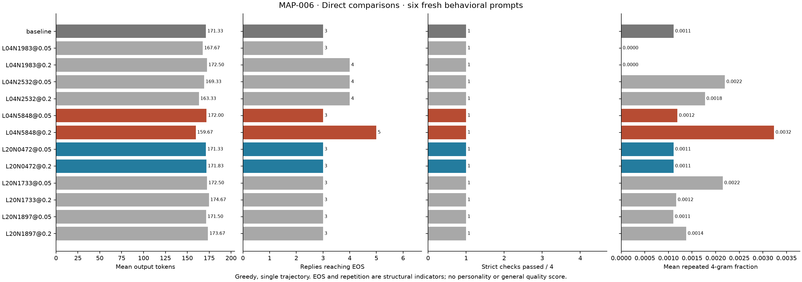
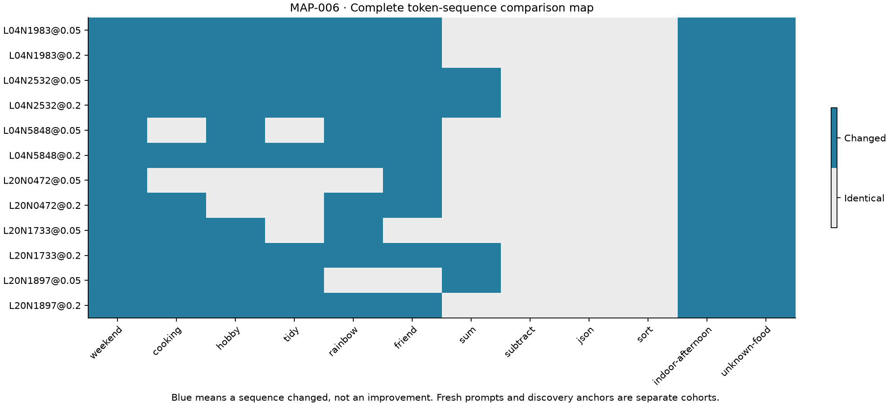

# MAP-006: fresh compression/completion comparisons

Status: completed; neither primary criterion met. The design below was predeclared before generation. Target candidates were selected from inspected MAP-005 outcomes. Fresh prompts were written before this run and were not used to select candidates.

Use the frozen CAL-001 numeric evidence to recover positive offsets for L04N5848 and L20N0472 at 5% and 20%. For each layer, choose two other channels randomly (seed 20261108) from those with both strengths uncapped, actual calibration means within ±25% of target, and mean next-token KL ≤0.5. Controls match sparse size and approximate achieved local strength; they are not matched on semantic selectivity. Save the selection before generating.

Six fresh behavioral prompts, four fresh exact checks, and two labeled discovery anchors. Same neutral system as MAP-005, greedy BF16, 192-token cap. Twelve intervention conditions × twelve prompts + twelve baselines + two hook checks = **158 generations**. Preserve every outcome. Read fresh and anchor cohorts separately.

Primary compression criterion (L04N5848 positive, 20%): at least four of six fresh behavioral replies shorter; their mean tokens reduced at least 10%; reduction exceeds both same-layer random controls; no fresh exact-check losses; no additional fresh behavioral EOS failures. Primary completion criterion (L20N0472 positive, 20%): at least one fresh behavioral baseline cap repaired, no new fresh behavioral cap, and no fresh exact-check loss. If baseline completes all six, completion replication is inconclusive. Show control outcomes even if a criterion passes. Five-percent doses explore sensitivity, not a substitute success criterion.

Capture actual prefill relative changes for each reply, source/config hashes, schedule, tokens/text, timing, EOS, exact checks and repetition. These checks are narrow and single-trajectory. Successful replication would support these limited prompt-level effects; it would not establish a stable personality or general capability gain.

## Results

Run `20261106T200050651270Z-MAP-006-offset-replication` completed all 158 generations. Source hashes, the 144-trial intervention schedule, zero-offset and removed-hook token checks, and unchanged parameter-version counters verify. [Numeric evidence](evidence/MAP-006/metrics.json) retains every condition and separates fresh behavior, fresh checks and anchors.

| Fresh behavior, n=6 | Mean tokens | Reaching EOS | Shorter than matched default |
|---|---:|---:|---:|
| Default | 171.33 | 3/6 | — |
| L04N5848 positive, 20% target | 159.67 | 5/6 | 4/6 |
| Same-layer control L04N1983, 20% | 172.50 | 4/6 | See export |
| Same-layer control L04N2532, 20% | 163.33 | 4/6 | See export |
| L20N0472 positive, 20% target | 171.83 | 3/6 | 0/6 |
| Same-layer control L20N1733, 20% | 174.67 | 3/6 | See export |
| Same-layer control L20N1897, 20% | 173.67 | 3/6 | See export |

L04N5848 reduced mean length by **6.81%**, below the required 10%, despite four shorter replies, two repaired caps and a greater reduction than both controls. No fresh exact check was lost or fresh cap added. This supports a limited shortening observation, not the declared compression success. The 5% setting averaged 172 tokens with 3/6 EOS.

L20N0472 repaired none of the three fresh baseline caps and shortened none of the six fresh behavioral replies. Its earlier completion effect did not replicate. This is a failed criterion, not an inconclusive all-defaults-finished case. Its 5% setting matched default mean length and EOS count.

Fresh exact checks were weak: default and every condition passed only **1/4**. No loss on this small set does not establish capability preservation. On the two discovery anchors, default averaged 135.5 tokens with 1/2 EOS, versus 54 tokens and 2/2 EOS for L04N5848 at 20%; do not pool this selected-anchor improvement with fresh evidence.

