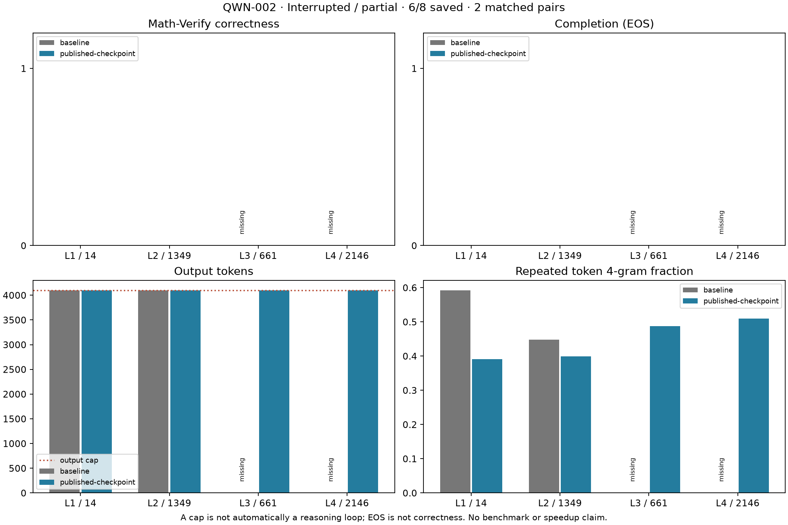

# QWN-002: bounded thinking-on Qwen base/edit pilot

Status: **stopped by user request after 6/8 saved trajectories; not a completed pilot**. The protocol below was predeclared as commit aedb63b before generation. No pilot outcome was used to select problems or settings.

## Interrupted results

Run `20261106T213644088335Z-QWN-002-anti-loop-pilot` was stopped when the user needed to leave. Six full trajectories and 832 tokens from the seventh are preserved locally. The eighth was never started. No full-study summary exists. [Numeric evidence](evidence/QWN-002/metrics.json) independently checks 19 source archives, regrades all six saved rows and verifies identical tokenized inputs for the **two complete matched pairs**.

| Problem / checkpoint | Tokens | EOS | Final box | Repeated 4-gram fraction |
|---|---:|---|---|---:|
| Level 1 / base | 4,096 | No | Missing | 0.5917 |
| Level 1 / edit | 4,096 | No | Missing | 0.3916 |
| Level 2 / base | 4,096 | No | Missing | 0.4476 |
| Level 2 / edit | 4,096 | No | Missing | 0.3997 |
| Level 3 / edit | 4,096 | No | Missing | 0.4879 |
| Level 4 / edit | 4,096 | No | Missing | 0.5099 |

Baseline level 3 is interrupted, not a full-budget counterpart; baseline level 4 is absent. Do not pool unmatched denominators into an apparent base/edit accuracy comparison. Every saved full sample scores false under the frozen final-box rule because its final box is missing; this does not mean every intermediate calculation is wrong. Non-blinded trace inspection shows repeated reconsideration of interpretations/steps rather than a finished final answer. For example, the probability trace calculates the simple setup early and then repeatedly reopens the candidates' identities. The diagram trace repeatedly revisits axes/coordinates. This is qualitative inspection, not a validated semantic loop detector.

The two paired samples show less exact token repetition under the edit, **without completion or final-answer improvement at 4K**. This does not reproduce or refute the upstream 32K benchmark. No prompts were replaced or samples rerolled. Teacher-forced cache/actual-loaded-weight diagnostics are implemented but were not run after the stop request. See [device handoff](../docs/HANDOFF.md) before continuing, especially on Mac.



## Frozen question and scope

Does the published Qwen3.5-0.8B edit improve paired answer/completion behavior on four sampled MATH-500 problems under a common local thinking-on sampling setup? This is an exploratory Windows/Transformers pilot, not reproduction of the publisher's full vLLM/H200 benchmark percentages. The two pinned models and all settings/order are frozen in [qwen-pilot.json](../configs/qwen-pilot.json).

The base revision is `2fc06364715b967f1860aea9cf38778875588b17`; the published edit revision is `d1671a178705bcab7644806d23c535517f35723b`. [Full CPU audit](evidence/QWN-002/weights.json) compared all 488 tensor keys, shapes, dtypes and byte digests: only the expected layer-15/layer-19 down-projections differ, each in 64 columns. Their edited digests match the published digests. The addressed columns contain 131,072 positions; **130,188 are bitwise different**, with 884 unchanged positions inside those columns. The publisher's addressed-weight count is not the same as a bytewise changed-element count. Original checkpoints remain unchanged.

## Outcome-blind dataset selection

Dataset: `HuggingFaceH4/MATH-500`, revision `6e4ed1a2a79af7d8630a6b768ec859cb5af4d3be`, `test.jsonl` SHA-256 `35dc41080a3680858b27fa7e0533d2d547825316fc5dafe5d316f4ccc5a06132`. Choose one problem at each level 1–4 by the smallest SHA-256 of `20261109:<unique_id>` within that level. No selection from model-generated answers; no replacement based on difficulty or desired results. The selected manifest is recorded by digest in the config and archived with the run. `prepare_qwen_pilot.py` regenerates it from the pinned dataset revision.

| Level | ID | Subject |
|---:|---|---|
| 1 | test/counting_and_probability/14.json | Counting & Probability |
| 2 | test/algebra/1349.json | Algebra |
| 3 | test/algebra/661.json | Algebra |
| 4 | test/intermediate_algebra/2146.json | Intermediate Algebra |

The level-2 problem includes Asymptote diagram source. Preserve that source as text, as provided by this dataset; no rendered image or vision input is used. This limitation remains in the results rather than replacing the problem. Four stratified problems are not a representative benchmark sample.

## Generation, sampling and grading

One trajectory per checkpoint/problem, seed 0 reset per trajectory; no system instruction. Original problem text plus the exact suffix `Please reason step by step, and put your final answer within \boxed{}.` (preceded by a newline; the JSON config defines the actual single-backslash text). Use the pinned tokenizer template with `enable_thinking=True`. BF16, native Transformers 5.22.2, SDPA; the existing Windows convolution/gated-delta reference fallbacks remain. Greedy chat is unchanged.

Temperature 0.6, top_k 20, top_p 0.95, presence penalty 1.5. Presence subtracts 1.5 once for each token seen in **generated output only**, before temperature/top-k/top-p; prompt tokens and occurrence counts do not contribute. Repetition penalty stays 1.0. These semantics and ordering were checked against [vLLM 0.33.0 penalties](https://github.com/vllm-project/vllm/blob/v0.33.0/vllm/model_executor/layers/utils.py) and [sampler ordering](https://github.com/vllm-project/vllm/blob/v0.33.0/vllm/v1/sample/sampler.py). HF warpers pass an independent small-distribution calculation. RNG/backend implementations differ from vLLM, so identical seeds do not imply identical cross-backend sequences.

Stop on the tokenizer EOS or the checkpoint generation-config EOS, output cap or cumulative wall budget. Each planned trajectory has up to **4,096 output tokens**, at most **32,768 pilot tokens** total. Two eight-token repeated sanity samples per checkpoint contribute at most **32 additional validation tokens**, recorded separately; this explicit reservation is a pre-run clarification of the work plan. Everything, including model loading, sanity checks and grading, shares a 30-minute cumulative run budget. Deadline checks occur between generated tokens/trials; a running kernel or grader can overrun by its in-flight operation/15-second grading timeout.

Order: base levels 1/2; edit levels 1/2/3/4; base levels 3/4. This requires three checkpoint loads and counterbalances which checkpoint is first for two of four pairs. Within each pair prompt/settings/seed match. Loading, prefill, first-token, decode and memory measurements are retained, but single observations do not establish speed improvement.

Use the **last balanced `\boxed{...}`** in the complete generated text and Math-Verify **0.9.0** with antlr4 4.13.2. Do not substitute an earlier correct box when the final box is wrong or unfinished. Missing/unclosed final boxes score false with an explicit extraction status. Parse/equivalence runs in an isolated CLI process with a 15-second outer timeout; Math-Verify's internal Windows multiprocessing timeouts are disabled inside that child. A grader error interrupts the run and preserves its active trajectory; it is not silently scored as an incorrect answer.

## Integrity and interpretation

Before pilot prompts, each checkpoint must pass finite/cached first-logit checks, thinking-on/off template distinction and exact repeatability of two seeded eight-token sanity samples. Save actual max logit differences without claiming numerical equivalence. Archive inputs, code/config/lock hashes, full checkpoint audit, actual token IDs/text, template/runtime, timings, per-trajectory parameter-version counters and complete outputs. Save partial token streams every 64 tokens and on generation exceptions. OOM, non-finite logits, failed identity/scoring or budget exhaustion stops the run.

Resume only a valid unique completed schedule prefix under identical current/archived source/config/runtime hashes and remaining cumulative budgets. Refuse to reroll an unfinished trajectory or finalized run. Resume is a between-trajectory continuation, not KV-cache/RNG restoration of an interrupted sample. Partial records remain reviewable.

Report every pair's correctness, extracted answer, EOS/cap, repeated token 4-gram fraction, length and timings. Review repetitive text manually, recording repeated reasoning versus legitimate structure. A token cap is not by itself a loop and EOS is not by itself correctness. No post-hoc prompt substitution, rerolling or damage exclusion. Improvements and regressions are paired observations only; inconclusive outcomes and failures are valid milestones. Any broader claim needs a separately frozen fresh sample/multiple seeds and a larger output budget.

## Reproduce

```powershell
uv sync --locked --extra eval --extra analysis
uv run --locked --extra eval python scripts/prepare_qwen_pilot.py
uv run --locked --extra eval python scripts/qwen_audit.py
uv run --locked --extra eval python -m unittest discover -s tests
uv run --locked --extra eval python scripts/qwen_eval.py
# Only for a stopped run with no unfinished sample, unchanged hashes and budget left:
uv run --locked --extra eval python scripts/qwen_eval.py --resume RUN-ID
```

Dataset source: [pinned MATH-500](https://huggingface.co/datasets/HuggingFaceH4/MATH-500/tree/6e4ed1a2a79af7d8630a6b768ec859cb5af4d3be). Reference protocol: [pinned released model card](https://huggingface.co/RikiyaT/Qwen3.5-0.8B-weight-space-programming/blob/d1671a178705bcab7644806d23c535517f35723b/README.md). These references are upstream evidence, not local pilot outcomes.
